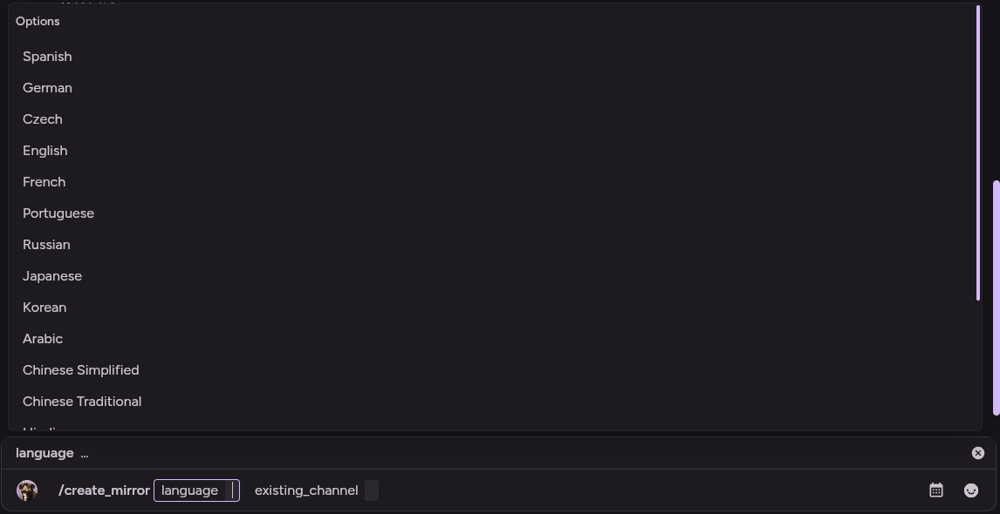
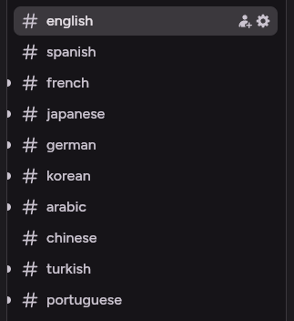
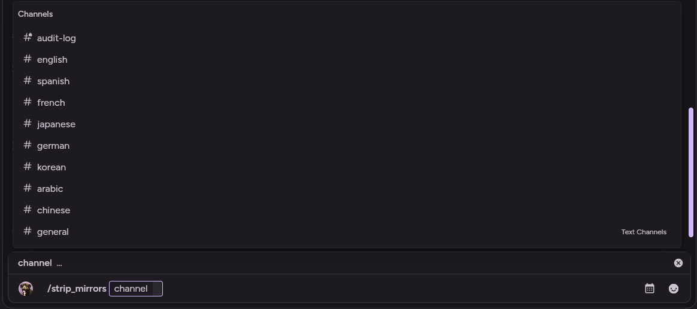
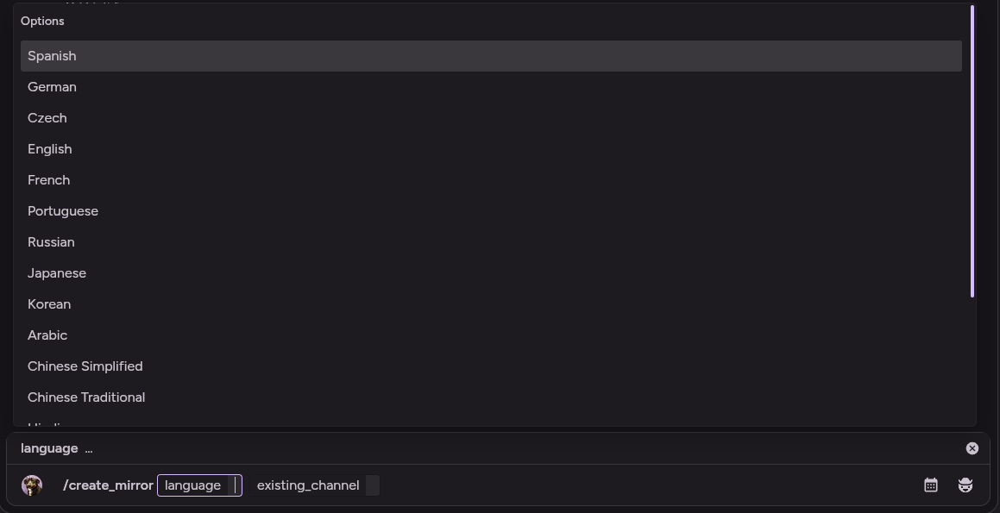

# Discord Translation Bot

## Table of contents:

| Categories    | What's shown?|
| ------------- |:-------------:|
| [Overview](#over) | Project Overview. |
| [Setup](#set) | Setup/Installation instructions. |
| [Usage](#use) | How to use this program. |
| [Used Resources](#res) | All resources used in this repo. |

<a name="over"></a>
  
### Overview
Sometimes you don't speak the same language as your friends. This bot creates mirrors that translates every message between channels into other languages, allowing for anyone to read any message in their native language.

<a name="set"></a>

### Setup

#### Prerequisites
- A locally hosted version of libretranslate open on localhost:5000
- A discord bot token

#### Installation
**Clone With Git**
```bash
git clone https://Tranquil-M/discord-translation; cd discord-translation
```

**Install With Pip**
```bash
pip install .
```

<a name="use"></a>
### Usage
**Execute Using Alias**
```bash
discord-translation
```
> [!IMPORTANT]
> Ensure that you are in the correct environment you installed the package in.

<a name="create"></a>
**Create A Channel Mirror**
| Command | Output |
| - | - |
|  |  |
> [!NOTE]
> Creates a new channel tied to this mirror. This channel can be manipulated in any way, and it will still translate properly.

**Strip Mirrors**
| Command | Output |
| - | - |
|  |  |
> [!NOTE]
> Removes all mirrors attatched to a channel. The mirrors can be re-instated to that channel using the [Create Mirror](#create) command.

**Manually Translate Anything**
| Command | Output |
| - | - |
|  |  |
> [!NOTE]
> Performs as a translation and returns as an ephemeral, meaning only you can see the translated message.

<a name="res"></a>

## Resources
* [Discord.py](https://discordpy.readthedocs.io/en/stable/)

- - -
[](https://ko-fi.com/I2I61Z3QJH)
